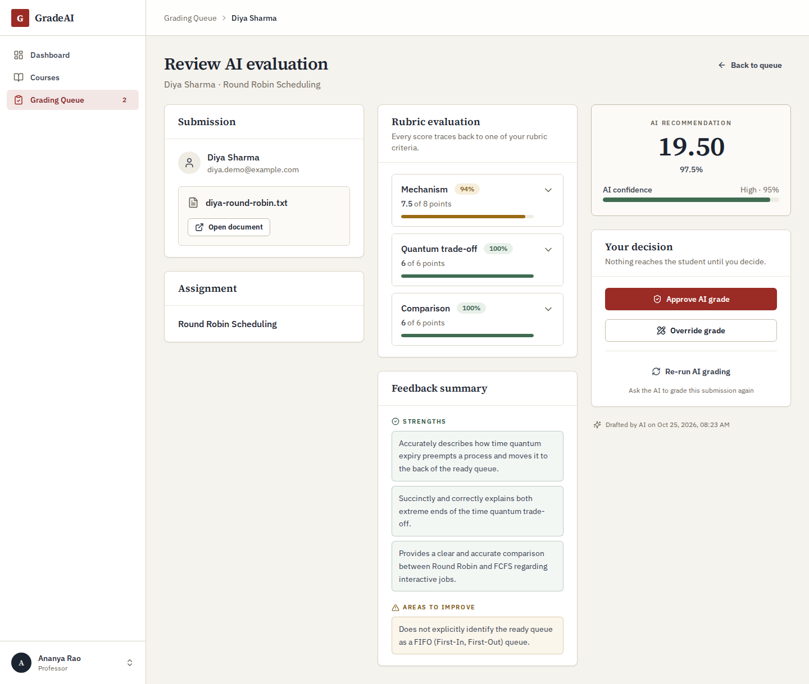
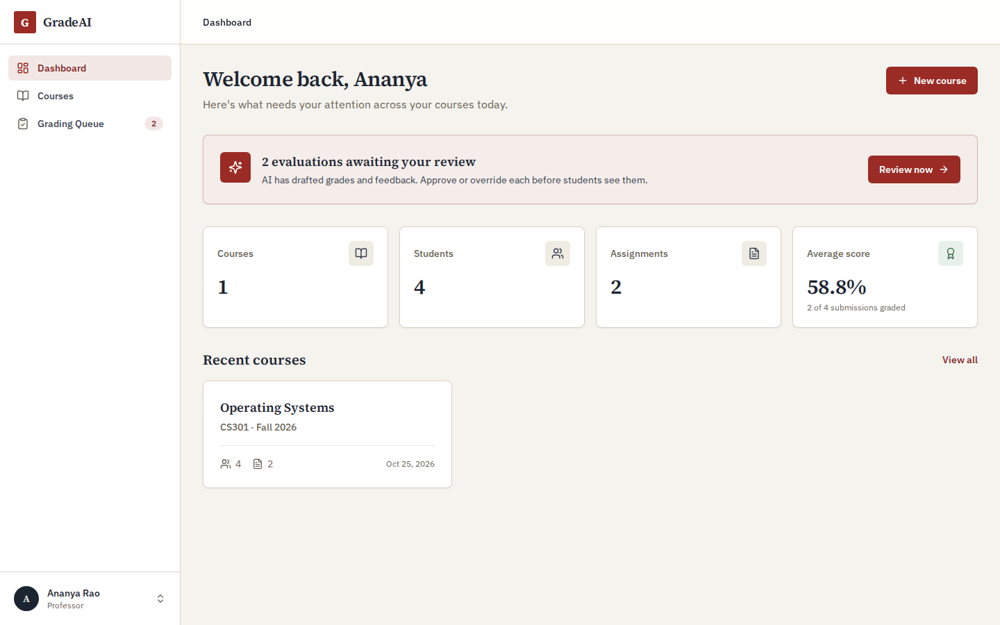
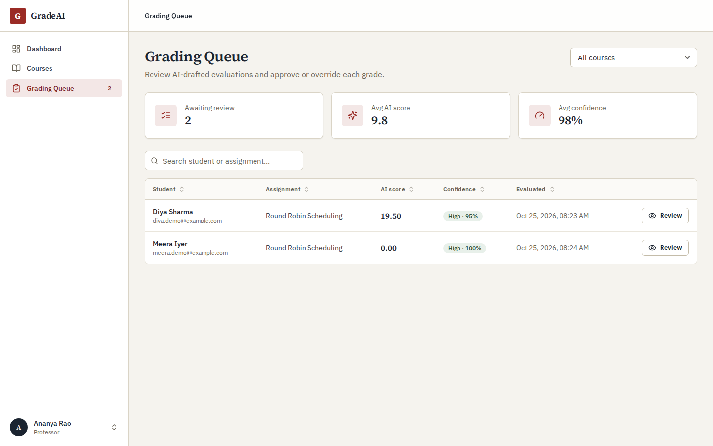
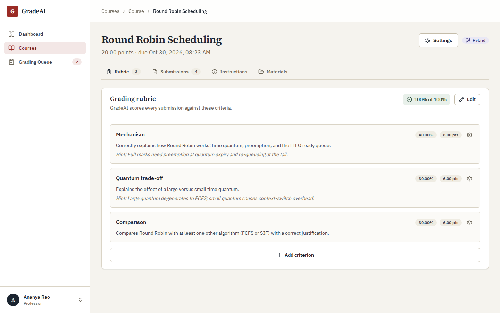
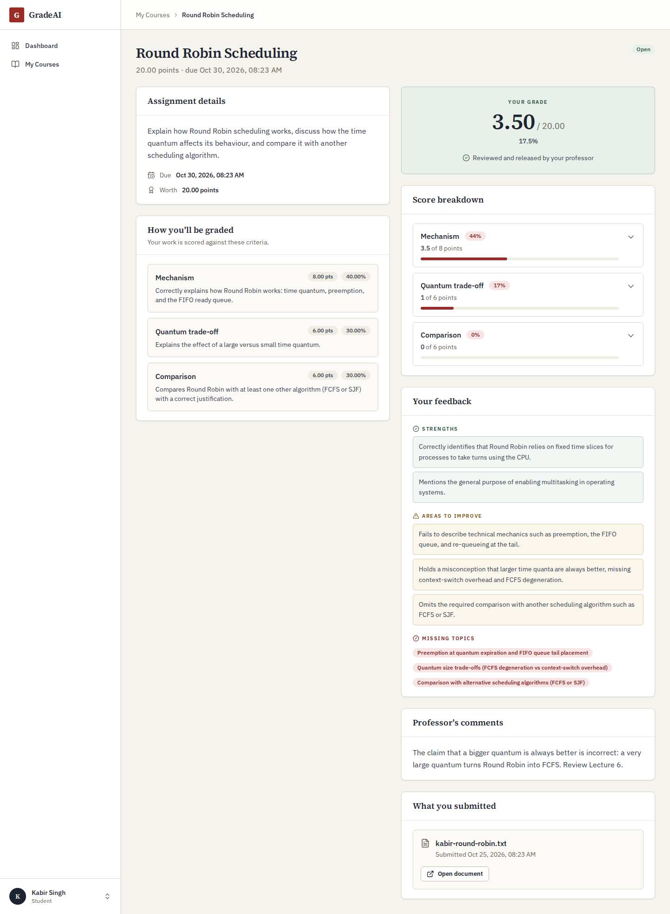

# GradeAI

[](https://github.com/Iampranjaldubey/Grade.AI/actions/workflows/ci.yml)
[](https://www.python.org/)
[](https://reactjs.org/)
[](LICENSE)

AI-assisted grading for university courses. A professor defines a rubric and uploads course
material; GradeAI drafts a score and per-criterion feedback for every submission using a
retrieval-augmented pipeline over that material. **Nothing reaches a student until a professor
approves or overrides it.**

**Stack:** FastAPI · PostgreSQL · Celery + Redis · ChromaDB · Google Gemini · React 18 +
TypeScript · Docker



---

## Features

- **Rubric-based AI grading.** Each criterion is scored separately with reasoning, plus
  strengths, weaknesses, missing topics, and a confidence value.
- **Grounded in course material.** Lecture notes and sample solutions are parsed, chunked,
  embedded, and retrieved per submission, so grading follows the course's own content.
- **Human in the loop.** AI grades land in a review queue; the professor approves, overrides
  with their own score and comments, or re-runs grading. Students see only released grades.
- **Three grading modes.** `hybrid` (AI drafts, professor reviews), `auto` (AI grades are
  released directly), and `manual` (professor only).
- **Safe failure.** If the model is unavailable, the submission gets a clearly flagged
  placeholder that is never auto-released, even in `auto` mode.
- **Separate professor and student portals** with role-based access throughout.

| Professor dashboard | Grading queue |
| --- | --- |
|  |  |
| **Rubric editor** | **What the student sees** |
|  |  |

---

## How grading works

```
Student upload ──▶ S3/MinIO ──▶ Celery: parse PDF/DOCX/TXT ──▶ chunk ──▶ embed ──▶ ChromaDB
                                                                                    │
Professor's rubric (Postgres) ───────────────┐                                      │
                                             ▼                                      ▼
                         Celery: retrieve relevant notes + sample solution for this submission
                                             │
                                             ▼
                         Gemini, constrained to a JSON schema: one judgement per criterion
                                             │
                                             ▼
                         Validate against the rubric, compute the total ──▶ review queue
                                             │
                         Professor approves / overrides ──▶ grade released to the student
```

1. A professor creates a course and an assignment with a rubric. Criterion weights must total
   100% and criterion points must add up to the assignment's maximum score.
2. Course material is uploaded straight to object storage via presigned URLs. A Celery worker
   extracts the text, splits it into overlapping chunks, embeds them locally with
   `all-MiniLM-L6-v2`, and indexes them in a per-course ChromaDB collection.
3. A student's submission goes through the same pipeline, and grading is queued as soon as it
   is indexed.
4. The worker retrieves the most relevant notes and sample-solution passages and sends them to
   Gemini with the rubric and the submission.
5. The result is validated and stored; the professor reviews it in the grading workspace.

---

## Design decisions

**The model judges; the server scores.** Gemini returns output constrained to a Pydantic
schema (structured output), with one entry per criterion. The backend matches entries back to
the rubric, clamps each score to that criterion's range, rejects responses that skip a
criterion, and computes the total and percentage itself. A model arithmetic slip or a made-up
criterion can't change a grade.

**Failures are explicit.** Rate limits, overloaded-model errors, timeouts, and malformed output
are retried, then a configurable fallback model is tried. An invalid API key stops immediately.
If everything fails, the result is a placeholder marked `is_fallback` with zero confidence, so
it always goes to a human. Each grade records which model produced it.

**Slow work runs in the background.** Parsing, embedding, and LLM calls take seconds to
minutes, so they run in Celery workers with soft and hard time limits, and the UI polls for
status. Workers acknowledge tasks late, so a crash mid-task leads to a retry, not a lost grade.

**Grading decisions are protected.** Approve and override use an atomic compare-and-swap, so
two clicks can't overwrite each other, and re-running AI grading never replaces a decision a
professor has already made. Approvals, overrides, and manual grades are written to an audit
log.

**Security**
- Argon2 password hashing and short-lived JWT access tokens.
- Refresh tokens are stored in a Redis allowlist and rotated on every use; access tokens are
  blacklisted on logout.
- Per-account login lockout and per-IP rate limits on registration and upload URLs.
- Professor self-registration requires an institution code in production.
- Every read and write checks ownership: professors see only their own courses and students
  only their own work.
- Uploads are size-checked against the stored object rather than the client's claim, and
  their content is verified by magic bytes before parsing. The bucket stays private and files
  are served only through short-lived presigned URLs.

---

## Quick start

Requires **Docker** with Docker Compose.

```bash
git clone https://github.com/Iampranjaldubey/Grade.AI.git
cd Grade.AI
make dev            # creates .env files on first run and starts all services
```

To enable AI grading, add a [Google Gemini API key](https://aistudio.google.com/apikey) to
`backend/.env` and restart the backend and worker:

```bash
# backend/.env
GEMINI_API_KEY=your-key-here
```

```bash
docker compose restart backend celery-worker
```

In a second terminal, create the storage bucket and the database schema:

```bash
./scripts/setup-minio.sh
make migrate
```

### Demo data

```bash
make seed-demo
```

This creates an Operating Systems course with a three-criterion rubric, indexed lecture notes
and a model answer, and four submissions ranging from excellent to off-topic, all graded by
Gemini. One grade is approved, one is overridden, and two are waiting for review. It needs a
Gemini key and takes a minute or two.

| Role | Email | Password |
| --- | --- | --- |
| Professor | `prof.demo@example.com` | `demo-pass-123` |
| Student (approved grade) | `aarav.demo@example.com` | `demo-pass-123` |
| Student (overridden grade) | `kabir.demo@example.com` | `demo-pass-123` |
| Student (awaiting review) | `diya.demo@example.com` | `demo-pass-123` |

### Services

| Service | URL |
| --- | --- |
| App | http://localhost:3000 |
| API docs (Swagger) | http://localhost:8000/docs |
| Through the nginx proxy | http://localhost |
| MinIO console | http://localhost:9001 (`minioadmin` / `minioadmin`) |

Other targets: `make up`, `make down`, `make logs`, `make test`, `make lint`.

---

## Tech stack

**Backend:** FastAPI (async), SQLAlchemy 2 + Alembic, PostgreSQL 16, Celery with a Redis
broker, ChromaDB, sentence-transformers for local embeddings, the `google-genai` SDK,
pdfplumber and python-docx for parsing, boto3 for S3/MinIO, structlog with request-ID
correlation.

**Frontend:** React 18 + TypeScript (Vite), React Router v7, TanStack Query, Zustand, React
Hook Form + Zod, Tailwind CSS, Radix UI primitives.

**Infrastructure:** Docker Compose for local development, nginx as the edge proxy, GitHub
Actions CI, ECS task definitions for AWS deployment.

```
nginx ──┬── frontend (React SPA)
        └── /api ── FastAPI ──┬── PostgreSQL   (system of record)
                              ├── Redis        (token allowlist/blacklist, Celery broker)
                              ├── S3 / MinIO   (uploaded documents)
                              └── Celery ──┬── ChromaDB (vector search)
                                           └── Gemini   (grading)
```

---

## Testing

```bash
make test                              # both suites
cd backend  && pytest --cov=app        # 164 tests, 80% coverage gate
cd frontend && npm run test            # Vitest + React Testing Library
```

Backend tests run against in-memory SQLite with every external service (Postgres, Redis,
S3, ChromaDB, Gemini) stubbed or pointed at an unreachable address, so the suite can never
touch real data or spend API quota.

CI runs on every pull request:
- **Backend:** ruff, black, pytest with coverage, mypy
- **Frontend:** ESLint, `tsc`, Vitest, a production build
- **Docker:** builds the images and checks that the full stack comes up healthy

---

## Configuration

All settings are environment variables. See [`backend/.env.example`](backend/.env.example) for
the annotated list. The ones that matter most:

| Variable | Notes |
| --- | --- |
| `GEMINI_API_KEY` | Without it, every submission gets the flagged placeholder |
| `GEMINI_MODEL` / `GEMINI_FALLBACK_MODEL` | Pinned model versions, so grades stay reproducible |
| `JWT_SECRET` | The app refuses to start in production with the default |
| `PROFESSOR_REGISTRATION_CODE` | Required in production; otherwise anyone could register as a professor |
| `MAX_UPLOAD_SIZE_BYTES` | Checked against the stored object, not the client's claim |

In production the app validates its configuration at startup and refuses to boot if a
required value is missing or still at an insecure default.

---

## Limitations and next steps

- Grading accuracy hasn't yet been measured against human graders. The next planned step is
  an evaluation set of human-graded submissions with agreement metrics.
- Retrieval is vector-only; hybrid keyword + vector search with reranking is a planned
  improvement.
- The UI polls for grading status instead of receiving push updates.
- The AWS deployment workflows and ECS task definitions exist, but the AWS resources they rely
  on aren't provisioned by this repository. See [.github/SECRETS.md](.github/SECRETS.md).

---

## License

[MIT](LICENSE)
